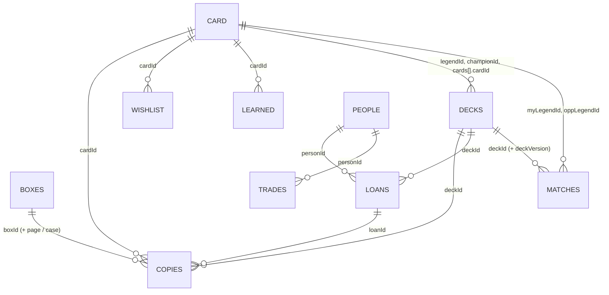

# RiftMancer — données et base de données

*English version: [DATABASE.md](DATABASE.md).*

Où RiftMancer garde ses données, sous quelle forme, et comment le téléphone et
le PC restent d’accord. Écrit d’après le code (21/11/2026, version 2.2.0) ; les
fichiers cités ici font foi quand quelque chose change.

## Sommaire

1. [Vue d’ensemble](#1-vue-densemble)
2. [Règles communes à tous les enregistrements](#2-règles-communes-à-tous-les-enregistrements)
3. [PC : SQLite](#3-pc--sqlite)
4. [Téléphone : IndexedDB](#4-téléphone--indexeddb)
5. [Les collections synchronisées, champ par champ](#5-les-collections-synchronisées-champ-par-champ)
6. [Liens entre les collections](#6-liens-entre-les-collections)
7. [Le catalogue des cartes (hors de la base)](#7-le-catalogue-des-cartes-hors-de-la-base)
8. [meta : réglages et état de chaque appareil](#8-meta--réglages-et-état-de-chaque-appareil)
9. [Synchronisation téléphone ↔ PC](#9-synchronisation-téléphone--pc)
10. [Sauvegardes et restauration](#10-sauvegardes-et-restauration)
11. [Autres fichiers et stockages](#11-autres-fichiers-et-stockages)
12. [Où tout se trouve sur le disque](#12-où-tout-se-trouve-sur-le-disque)
13. [Faire évoluer le schéma](#13-faire-évoluer-le-schéma)

---

## 1. Vue d’ensemble

RiftMancer n’a **pas de schéma relationnel**. Chaque donnée de l’utilisateur
est un **document JSON** (un « enregistrement ») dans une **collection** :
`copies`, `decks`, `matches`… Les deux applis stockent les mêmes collections,
chacune avec son moteur :

| | Appli PC (Electron) | Appli Android (Capacitor) |
|---|---|---|
| Moteur | SQLite (`node:sqlite`, intégré au Node d’Electron, sans module natif) | IndexedDB (bibliothèque `idb`) |
| Fichier / nom | `collection.sqlite` dans le dossier de données | base `riftbound-collection`, version 7 |
| Code | `electron/store.cjs` | `src/lib/collectionDB.js` |
| Rôle | **centre de la synchro** : garde l’ordre des changements (`seq`) | marque ses propres changements pas encore envoyés (`dirty`) |

L’interface ne parle jamais directement à un moteur : `src/lib/collectionDB.js`
donne la même API des deux côtés (`loadRecords`, `putRecords`, `getMeta`,
`setMeta`…) ; sur le PC, elle passe par l’IPC (`window.riftboundDesktop.db`)
jusqu’au processus principal.

Ce qui **n’est pas** dans la base :

- le **catalogue des cartes** (noms, textes, images, signatures IA) : un
  fichier JSON lu en mémoire ([section 7](#7-le-catalogue-des-cartes-hors-de-la-base)) ;
- les **prix Cardmarket** sur le PC (`prices.json`), les **mises à jour du
  contenu** (`catalogue/`), les **sauvegardes**, les préférences de
  l’interface (`localStorage`) ([section 11](#11-autres-fichiers-et-stockages)).

## 2. Règles communes à tous les enregistrements

| Champ | Type | Sens |
|---|---|---|
| `id` | texte (1 à 99 caractères) | clé unique dans sa collection ; un UUID v4 aléatoire (`newId()`), sauf la liste de souhaits (`wish:<cardId>`) et les données de démonstration (préfixe `demo:`) |
| `createdAt` | nombre (ms depuis 1970) | création |
| `updatedAt` | nombre (ms) | dernier changement : **le plus récent gagne** à la synchro |
| `deleted` | booléen | **pierre tombale** : l’interface n’efface jamais rien ; une suppression est un changement comme un autre, pour qu’elle arrive sur l’autre appareil |
| `dirty` | 0 / 1 (téléphone seulement) | changement local pas encore envoyé au PC ; retiré de l’enregistrement avant qu’il quitte le téléphone |

Un enregistrement sans `id` texte ou sans `updatedAt` numérique est ignoré par
le PC (`isValid` dans `electron/store.cjs`). Les données d’une carte (nom,
texte, extension…) ne sont **jamais recopiées** dans un enregistrement : seul
l’identifiant de la carte (`cardId`), cherché dans le catalogue.

## 3. PC : SQLite

`electron/store.cjs`, fichier `collection.sqlite`, journal en mode WAL.

```sql
CREATE TABLE IF NOT EXISTS records (
  collection TEXT NOT NULL,          -- 'copies', 'decks', 'matches'…
  id         TEXT NOT NULL,          -- l’id de l’enregistrement
  data       TEXT NOT NULL,          -- l’enregistrement entier, en JSON
  updatedAt  INTEGER NOT NULL,       -- copie de data.updatedAt (fusion)
  deleted    INTEGER NOT NULL DEFAULT 0,  -- copie de data.deleted (0 / 1)
  seq        INTEGER NOT NULL,       -- position dans le journal des changements du PC
  origin     TEXT,                   -- qui l’a écrit : 'pc' ou l’id du téléphone
  PRIMARY KEY (collection, id)
);
CREATE INDEX IF NOT EXISTS records_seq ON records (seq);
CREATE TABLE IF NOT EXISTS meta (
  key   TEXT PRIMARY KEY,
  value TEXT NOT NULL                -- JSON
);
```

- **`seq`** : chaque écriture prend le numéro suivant (un seul compteur pour
  toute la base). Un téléphone demande « qu’est-ce qui a changé depuis le
  `seq` N » ; c’est l’horloge de la synchro, indépendante des dates des appareils.
- **`origin`** : permet au PC de ne pas renvoyer à un téléphone les
  enregistrements qu’il vient d’envoyer.
- **Écritures** : `putLocal` (changements faits sur le PC : toujours écrits,
  origine `pc`) et `merge` (enregistrements d’un téléphone : écrits seulement
  s’ils sont plus récents), chacune dans une transaction (`BEGIN` / `COMMIT`,
  `ROLLBACK` en cas d’erreur).
- **Lecture** : `load(collection)` rend les enregistrements vivants (`deleted = 0`).

## 4. Téléphone : IndexedDB

`src/lib/collectionDB.js`, base `riftbound-collection`, **version 7**.

| Magasin (clé `id`) | Index | Créé en version |
|---|---|---|
| `copies` | `by_card` (cardId), `by_updated` (updatedAt), `by_dirty` | 1 (`by_dirty` en 2) |
| `meta` (clé libre) | — | 2 |
| `wishlist` | `by_dirty` | 3 |
| `boxes`, `decks`, `people`, `loans` | `by_dirty` | 4 |
| `trades` | `by_dirty` | 5 |
| `matches` | `by_dirty` | 6 |
| `learned` | `by_dirty` | 7 |

Avant toute montée de version de la base, l’appli fait **une sauvegarde des
données telles qu’elles étaient** (`backupBeforeUpgrade`, motif « avant une
mise à jour des données »). Les toutes premières versions gardaient la
collection dans `localStorage` (`riftbound_scanned_cards`, des piles avec une
quantité) : `migrateLegacyCollection` les transforme une fois en un
enregistrement par exemplaire.

## 5. Les collections synchronisées, champ par champ

Les neuf collections de `SYNCED_COLLECTIONS` : synchronisées, sauvegardées,
restaurées. Chaque enregistrement a aussi `id`, `createdAt`, `updatedAt`,
`deleted` (section 2). `?` = facultatif ou `null`.

### copies — un exemplaire physique

Construit par `makeCopy()` (`src/lib/collectionDB.js`).

| Champ | Type | Sens |
|---|---|---|
| `cardId` | texte | carte du catalogue (`ogn-066-298`…) |
| `language` | texte | langue de la carte imprimée, `'English'` par défaut (`'French'`…) |
| `foil` | booléen | finition foil |
| `promo` | booléen | version promo |
| `condition` | texte | échelle Cardmarket (`src/lib/conditions.js`) : `'Near Mint'`… |
| `conditionOld?` | texte | état américain avant le passage à l’échelle Cardmarket |
| `paid?` | nombre | prix d’achat de cet exemplaire (€) |
| `boxId?` | texte | → `boxes.id` : rangé dans cette boîte |
| `binderPage?`, `binderSlot?`, `binderCols?` | nombres | page (à partir de 1), case (à partir de 1, sens de lecture) et cases par rangée (3 ou 4) dans une boîte classeur ; seulement avec un `boxId`, perdus quand l’exemplaire change de place (`src/lib/binder.js`) |
| `deckId?` | texte | → `decks.id` : dans ce deck |
| `loanId?` | texte | → `loans.id` : prêté |

Plusieurs exemplaires d’une même carte sont plusieurs enregistrements :
l’interface les regroupe en « piles » (même carte, langue, finition, état, place).

### wishlist — cartes recherchées

| Champ | Type | Sens |
|---|---|---|
| `id` | texte | **`wish:<cardId>`** : tiré de la carte, pour que les deux appareils modifient le même enregistrement |
| `cardId` | texte | carte recherchée |
| `quantity` | nombre | exemplaires voulus |
| `maxPrice?` | nombre | alerte de prix : prévenir quand le prix Cardmarket est égal ou inférieur (€) |

### boxes — endroits où ranger les cartes

| Champ | Type | Sens |
|---|---|---|
| `name` | texte | « Classeur rouge »… |
| `note` | texte | texte libre |

Une boîte devient un **classeur** dès que ses exemplaires ont une page et une case.

### decks

| Champ | Type | Sens |
|---|---|---|
| `name` | texte | nom du deck |
| `format?` | texte | `'standard'` par défaut, ou `'2v2'` |
| `legendId` | texte | Légende (id de carte) |
| `championId` | texte | Champion choisi (id de carte) |
| `cards` | `[{ cardId, quantity, zone }]` | la liste ; `zone` = `'main'`, `'rune'`, `'battlefield'` ou `'side'` (réserve) |
| `note` | texte | texte libre |
| `versions?` | `[{ n, name, at, legendId, championId, format, cards }]` | versions enregistrées (`src/lib/deckVersions.js`) : numéro, nom (60 caractères au plus), date et copie de la liste |
| `opponents?` | `{ [legendId]: { note, out: [{ cardId, quantity }], in: [...], at } }` | notes et plan de side par Légende adverse (`src/lib/opponentNotes.js`) ; **retirées de la copie publique hebdomadaire** des sauvegardes du téléphone |

### people — les amis

| Champ | Type | Sens |
|---|---|---|
| `name` | texte | nom |
| `note` | texte | texte libre |

### loans — prêts

| Champ | Type | Sens |
|---|---|---|
| `personId` | texte | → `people.id` |
| `deckId?` | texte | → `decks.id` quand un deck entier est prêté |
| `startedAt` | nombre (ms) | début |
| `returnedAt?` | nombre (ms) | rendu (null tant que c’est prêté) |
| `cardIds` | liste de textes | cartes prêtées (une entrée par exemplaire) |
| `note` | texte | texte libre |

### trades — échanges

| Champ | Type | Sens |
|---|---|---|
| `personId` | texte | → `people.id` |
| `date` | nombre (ms) | date de l’échange |
| `given` | `[{ cardId, quantity }]` | cartes données |
| `received` | `[{ cardId, quantity }]` | cartes reçues |
| `valueGiven?`, `valueReceived?` | nombres | valeurs au moment de l’échange (€) |
| `applied` | booléen | déjà appliqué à la collection |
| `note` | texte | texte libre |

### matches — parties jouées

| Champ | Type | Sens |
|---|---|---|
| `date` | nombre (ms) | quand |
| `mode?` | texte | `'1v1'`, `'2v2'` ou `'ffa'` (compteur de score) |
| `format` | texte | `'bo1'` ou `'bo3'` |
| `deckId?` | texte | → `decks.id` |
| `deckVersion?` | nombre | → `decks.versions[].n`, la version jouée |
| `myLegendId?`, `oppLegendId?` | textes | Légendes (ids de cartes) |
| `partnerLegendId?`, `oppLegendIds?` | texte, liste | 2v2 : Légendes du partenaire et des adversaires |
| `players?` | nombre | chacun pour soi : nombre de joueurs |
| `oppName?` | texte | nom de l’adversaire |
| `eventId?`, `eventName?`, `round?` | textes, nombre | tournoi (`ev:<nom>:<date>`) et ronde |
| `wentFirst?` | booléen | a commencé la première manche |
| `result` | texte | `'win'`, `'loss'` ou `'draw'` |
| `games` | `[{ result, wentFirst, myScore, oppScore }]` | manche par manche (vide pour une saisie rapide) |
| `notes?` | texte | texte libre |

### learned — ce que le scanner a appris des corrections

`src/lib/learning.js` : quand vous corrigez une reconnaissance, l’appli garde un exemple.

| Champ | Type | Sens |
|---|---|---|
| `cardId` | texte | la bonne carte |
| `f` | texte (base64) | empreinte couleur de la photo |
| `e?` | texte | signature IA de la photo (moteur du moment) |

Quelques exemples par carte au plus (les plus anciens sont supprimés) ; ils
comptent moins que le catalogue. Réglages → « Oublier ce que l’appli a
appris » les supprime tous (sur l’autre appareil aussi, par la synchro).

## 6. Liens entre les collections

Il n’y a pas de clé étrangère : les liens sont des ids, vérifiés par
l’interface. Un lien vers un enregistrement supprimé s’affiche « inconnu »
(ou est ignoré), jamais une erreur.



`CARD` est le catalogue (section 7), pas une table.

## 7. Le catalogue des cartes (hors de la base)

`card-hashes.json` : lu en mémoire par `src/lib/cardMatcher.js`, jamais écrit
par l’utilisateur. Dans la version publique, l’appli démarre avec son seul
en-tête (`catalog-base.json`) et récupère les cartes au premier lancement.

**En-tête** : `gridSize`, `featureFormat`, `generatedAt`, `embeddings`
(`engine`, `model`, `modelSha256`, `dim`, `views`, `alpha`, `decision` =
seuils de reconnaissance par taille d’image, `detector`, `detectorSha256`), et
sur le PC `content` (les mises à jour installées).

**Chaque carte** (`cards[]`) :

| Champ | Sens |
|---|---|
| `id` | `<extension>-<numéro>-<total>`, par ex. `ogn-066-298` |
| `name`, `nameEn?`, `nameFr?` | noms (officiel, anglais complet, français) |
| `text`, `textFr?` | texte de règles |
| `number`, `code`, `set`, `setName` | numérotation et extension |
| `domain`, `domains`, `rarity`, `type`, `superTypes?`, `signature?`, `tags` | données de jeu |
| `energy`, `might` | coûts et puissance |
| `illustrator`, `orientation` | illustration |
| `artBottom` | où finit l’illustration (reconnaissance) |
| `artGroup?` | rééditions à la même illustration |
| `f` | empreinte couleur (base64) |
| `e` | signature IA (base64) |
| `errata?` | textes modifiés par une mise à jour |

Images : `cards/<id>.webp` (grande taille) et `cards/thumbs/<id>.webp`.

**Mises à jour du contenu sur le PC** (`electron/content.cjs`) : des couches
au-dessus du catalogue livré, dans `catalogue/couches/{cartes,traductions,bannies}/layer.json`
(+ images), fusionnées dans `catalogue/actif/card-hashes.json`, servi à
l’appli et au téléphone. Chaque couche a `kind`, `format: 1`, `createdAt`,
`source`, `count`, `data`, `files` (SHA-256 de chaque image) ; la précédente
est gardée (`<kind>.precedent`), les textes modifiés sont notés dans
`catalogue/errata.json`, les vérifications hebdomadaires dans `catalogue/etat.json`.

## 8. meta : réglages et état de chaque appareil

Clé → valeur JSON, **jamais synchronisé** (chaque appareil a le sien).

| Clé | Où | Contenu |
|---|---|---|
| `pcId` | PC | identité de ce PC (UUID) |
| `token` | PC | secret du QR code d’appairage (« Régénérer la clé » le change) |
| `pcSecret` | PC | secret de ce PC (64 caractères hexadécimaux), créé une fois et donné à chaque téléphone à l’appairage (`pairing.pcSecret` sur le téléphone) |
| `devices` | PC | téléphones appairés : `{ [deviceId]: { key, name, firstSync, lastSync, appVersion } }` (la clé n’est jamais affichée) |
| `syncLog` | PC | historique des synchros (affiché dans Réglages) |
| `phoneOffer` | PC | « Envoyer sur le téléphone » en attente (date) |
| `valueHistory` | PC | valeur quotidienne de la collection : `[{ d, v, v7, vl, n }]` (730 jours) |
| `extraBackupDir` | PC | dossier de sauvegarde supplémentaire (clé USB…) |
| `lanSync` | PC | synchro par le Wi-Fi autorisée (oui par défaut) |
| `revokedDevices` | PC | **plus utilisée** : liste des téléphones dissociés des versions d’avant « une clé par téléphone » ; peut rester dans une ancienne base, plus lue par rien |
| `pairing` | téléphone | le PC appairé : `{ pcId, name, port, hosts, lastHost, deviceId, deviceKey, pcSecret }` |
| `since:<pcId>` | téléphone | dernière position du PC (`seq`) reçue de ce PC |
| `lastSync` | téléphone | date de la dernière synchro |
| `pcVersion` | téléphone | version de l’appli PC à la dernière synchro |
| `catalogVersion`, `catalogReceivedAt` | téléphone | catalogue reçu du PC (SHA-256, date) |
| `banlist`, `banlistVersion` | téléphone | cartes bannies reçues du PC |
| `prices` | téléphone | prix Cardmarket reçus du PC |
| `fullImages` | téléphone | télécharger les images en grande taille |
| `riftcodexNames` | téléphone | noms anglais complets (Riftcodex) : `{ fetchedAt, names }` ; sur le PC : `riftcodex-names.json` |

## 9. Synchronisation téléphone ↔ PC

Code : `src/lib/syncClient.js` (téléphone), `electron/server.cjs` (PC).
HTTP local, chaque requête signée (anti-rejeu), données chiffrées
(AES-256-GCM), une clé par téléphone appairé.

1. **Téléphone → PC** : le téléphone envoie, collection par collection, ses
   enregistrements `dirty = 1` et `since` = la dernière position du PC qu’il a
   reçue (`meta` `since:<pcId>`).
2. **Fusion sur le PC** (`Store.merge`) : un enregistrement est écrit s’il est
   nouveau ou si son `updatedAt` est **plus récent** que celui du PC. Si la
   version du PC a changé après `since` (sur le PC ou depuis un autre
   téléphone) et diffère, c’est un **conflit** : noté avec le côté gardé
   (`'phone'` ou `'pc'`) et affiché dans Réglages → Synchronisation. Même
   contenu à part les dates = pas de conflit.
3. **PC → téléphone** : les enregistrements dont le `seq` est après la
   position du téléphone, sauf ceux que ce téléphone vient d’envoyer (`changesSince`).
4. **Téléphone** : `applyRemote` écrit un enregistrement reçu s’il est plus
   récent que le sien, corrigé de l’écart d’horloge entre les deux appareils
   (`clockSkew`) ; ses changements locaux pas encore envoyés restent et partent
   à la synchro suivante. `markClean` efface ensuite `dirty` sur ce qui a été
   envoyé (sauf s’il a encore changé entre-temps).
5. **Catalogue, cartes bannies, prix, images** : en dehors des
   enregistrements ; le téléphone télécharge le catalogue du PC quand son
   SHA-256 a changé, puis les images manquantes.

L’appairage avec un nouveau PC marque tout `dirty` (`markAllDirty`) : toute la
collection part vers ce PC.

## 10. Sauvegardes et restauration

**PC** (`electron/store.cjs`, `electron/backups.cjs`) :

- copie de la base avec `VACUUM INTO` → `backups/collection-<date>.sqlite`
  (à l’ouverture, après une synchro avec des changements, à la fermeture) ;
  **30 gardées** ; copie possible dans un dossier supplémentaire ;
- **restauration** : le fichier de la base n’est pas remplacé. Chaque
  enregistrement de la sauvegarde est réécrit avec un nouveau `updatedAt`, et
  ceux qui n’y sont pas sont marqués supprimés : le téléphone reçoit l’état
  restauré à sa prochaine synchro.

**Téléphone** (`src/lib/autoBackup.js`, `src/lib/localBackup.js`) :

- fichier JSON `{ app: 'riftbound-scanner-backup', v: 1, at, reason, collections: { copies: [...], … } }`,
  enregistrements vivants seulement ; motifs : quotidienne, manuelle, avant une
  mise à jour des données, avant une restauration ;
- une par jour au plus, quand quelque chose a changé ; **10 gardées** dans le
  dossier de l’appli ;
- **copie hebdomadaire** dans `Documents/Riftbound` (gardée si l’appli est
  désinstallée), sans les notes sur les adversaires (`decks.opponents`) ;
- « Enregistrer une sauvegarde » / « Restaurer » avec un fichier.

## 11. Autres fichiers et stockages

| Quoi | Où | Contenu |
|---|---|---|
| Prix Cardmarket (PC) | `prices.json` | `{ updatedAt, priceDate, source, matched, total, cards: { [cardId]: [trend, trendFoil, idProduct, avg7, avg30, …] }, hist }` (`electron/prices.cjs`) |
| Noms anglais complets (PC) | `riftcodex-names.json` | noms Riftcodex |
| Sauvegardes en fichiers | IndexedDB `riftbound-backups` (navigateur) | magasin `files` |
| Banc de test | IndexedDB `rb-bench` | magasins `items` (clé `name`) et `photos` |
| Préférences de l’interface | `localStorage` (chaque appareil) | `rb.lang` (langue), `rb.displayFrench`, `rb.prefs`, `rb.collection.sort`, `rb.collectionLayout`, `rb.pc.*` (mise en page PC), `rb.playerName`, `rb.recentSearches`, `rb.counter.running` (compteur de score en cours), `rb.lastSpeed`, `rb.scanStats`, `rb.errors` (rapport de diagnostic), `rb.friends.myId`, `rb.prices.summarized`, `rb.startupMs`, `riftbound_trade_threshold` |
| Images et catalogue reçus (téléphone) | stockage privé de l’appli | `cards/<id>.webp`, `thumbs/<id>.webp`, `catalog/card-hashes.json` (`src/lib/nativeAssets.js`) |

Rien de tout cela n’est synchronisé : les préférences sont propres à chaque appareil.

## 12. Où tout se trouve sur le disque

**PC (Windows)** : `%APPDATA%\riftmancer\` (version de test : `riftmancer-test`)

```
collection.sqlite          la base (+ -wal, -shm)
backups\                   collection-<date>.sqlite (30)
catalogue\couches\         mises à jour du contenu (cartes, traductions, cartes bannies)
catalogue\actif\           le catalogue fusionné servi à l’appli et au téléphone
catalogue\errata.json      textes modifiés par les mises à jour
catalogue\etat.json        vérifications hebdomadaires
prices.json                prix Cardmarket
riftcodex-names.json       noms anglais complets
```

**Téléphone (Android)** : le stockage privé de l’appli (IndexedDB de la vue
web, images et catalogue reçus, sauvegardes automatiques), et
`Documents/Riftbound/` pour la copie hebdomadaire.

## 13. Faire évoluer le schéma

- **Un nouveau champ** dans un enregistrement : rien à migrer. Les anciens
  enregistrements ne l’ont pas : le lire avec une valeur par défaut
  (`deck.format || 'standard'`). Les deux applis doivent le connaître avant
  qu’il soit synchronisé.
- **Une nouvelle collection** : l’ajouter à `SYNCED_COLLECTIONS`, monter
  `DB_VERSION` dans `src/lib/collectionDB.js` et créer son magasin (avec
  `by_dirty`) dans `upgrade` ; rien à faire dans SQLite (une table pour toutes).
- **Changer une valeur stockée** (par ex. les états) : une migration qui
  réécrit les enregistrements avec un nouveau `updatedAt`, pour que l’autre
  appareil suive, et garde l’ancienne valeur si elle sert (`conditionOld`).
- Le téléphone fait une sauvegarde avant toute montée de version ; tests :
  `tests/collection.test.mjs`, `tests/sync*.test.cjs`, `tests/conflicts.test.cjs`,
  `tests/backups.test.mjs`.
