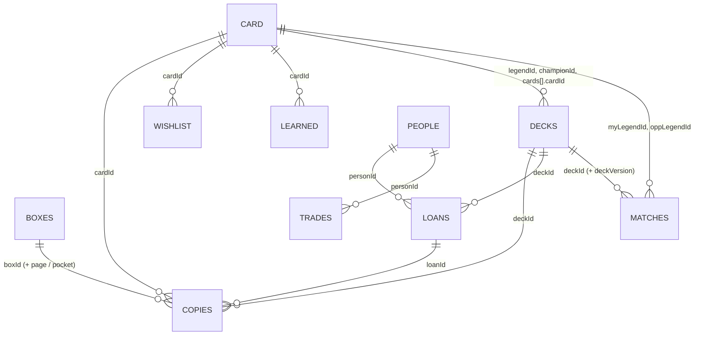

# RiftMancer — data and database

*Version française : [BASE-DE-DONNEES.md](BASE-DE-DONNEES.md).*

Where RiftMancer keeps its data, in what shape, and how the phone and the PC
stay in step. Written from the code (21/11/2026, version 2.2.0); the files
named here are the reference when something changes.

## Contents

1. [Overview](#1-overview)
2. [Common rules of every record](#2-common-rules-of-every-record)
3. [PC: SQLite](#3-pc-sqlite)
4. [Phone: IndexedDB](#4-phone-indexeddb)
5. [The synced collections, field by field](#5-the-synced-collections-field-by-field)
6. [Links between collections](#6-links-between-collections)
7. [The card catalog (not in the database)](#7-the-card-catalog-not-in-the-database)
8. [meta: settings and state of each device](#8-meta-settings-and-state-of-each-device)
9. [Sync between the phone and the PC](#9-sync-between-the-phone-and-the-pc)
10. [Backups and restore](#10-backups-and-restore)
11. [Other files and storage](#11-other-files-and-storage)
12. [Where everything is on disk](#12-where-everything-is-on-disk)
13. [Changing the schema](#13-changing-the-schema)

---

## 1. Overview

RiftMancer has **no relational schema**. Every piece of user data is a **JSON
document** (a « record ») in a **collection**: `copies`, `decks`, `matches`…
Both apps store the same collections, each with its own engine:

| | PC app (Electron) | Android app (Capacitor) |
|---|---|---|
| Engine | SQLite (`node:sqlite`, built into Electron's Node, no native module) | IndexedDB (library `idb`) |
| File / name | `collection.sqlite` in the data folder | database `riftbound-collection`, version 7 |
| Code | `electron/store.cjs` | `src/lib/collectionDB.js` |
| Role | **sync hub**: keeps the change order (`seq`) | marks its own unsent changes (`dirty`) |

The interface never talks to an engine directly: `src/lib/collectionDB.js`
gives the same API on both (`loadRecords`, `putRecords`, `getMeta`, `setMeta`…);
on the PC it goes through IPC (`window.riftboundDesktop.db`) to the main process.

What is **not** in the database:

- the **card catalog** (names, texts, pictures, AI signatures): a JSON file read
  into memory ([section 7](#7-the-card-catalog-not-in-the-database));
- the **Cardmarket prices** on the PC (`prices.json`), the **content updates**
  (`catalogue/`), the **backups**, the interface preferences (`localStorage`)
  ([section 11](#11-other-files-and-storage)).

## 2. Common rules of every record

| Field | Type | Meaning |
|---|---|---|
| `id` | string (1 to 99 characters) | unique key in its collection; a random UUID v4 (`newId()`), except the wish list (`wish:<cardId>`) and the demo data (`demo:` prefix) |
| `createdAt` | number (ms since 1970) | creation |
| `updatedAt` | number (ms) | last change: **the most recent wins** at the sync |
| `deleted` | boolean | **tombstone**: nothing is ever erased by the interface, a deletion is a change like any other, so that it reaches the other device |
| `dirty` | 0 / 1 (phone only) | local change not yet sent to the PC; removed from the record before it leaves the phone |

A record without a string `id` or a numeric `updatedAt` is ignored by the PC
(`isValid` in `electron/store.cjs`). Card data (name, text, set…) is **never
copied** into a record: only the card's id (`cardId`), looked up in the catalog.

## 3. PC: SQLite

`electron/store.cjs`, file `collection.sqlite`, journal in WAL mode.

```sql
CREATE TABLE IF NOT EXISTS records (
  collection TEXT NOT NULL,          -- 'copies', 'decks', 'matches'…
  id         TEXT NOT NULL,          -- the record's id
  data       TEXT NOT NULL,          -- the whole record, as JSON
  updatedAt  INTEGER NOT NULL,       -- copy of data.updatedAt (merge)
  deleted    INTEGER NOT NULL DEFAULT 0,  -- copy of data.deleted (0 / 1)
  seq        INTEGER NOT NULL,       -- position in the PC's change log
  origin     TEXT,                   -- who wrote it: 'pc' or the phone's device id
  PRIMARY KEY (collection, id)
);
CREATE INDEX IF NOT EXISTS records_seq ON records (seq);
CREATE TABLE IF NOT EXISTS meta (
  key   TEXT PRIMARY KEY,
  value TEXT NOT NULL                -- JSON
);
```

- **`seq`**: every write takes the next number (one counter for the whole
  database). A phone asks « what changed since `seq` N »; it is the PC's clock
  for the sync, independent of the devices' dates.
- **`origin`**: lets the PC leave out, in its answer, the records the same
  phone has just sent.
- **Writes**: `putLocal` (changes made on the PC: always written, origin
  `pc`) and `merge` (records from a phone: written only when newer), each in
  one transaction (`BEGIN` / `COMMIT`, `ROLLBACK` on error).
- **Reading**: `load(collection)` returns the live records (`deleted = 0`).

## 4. Phone: IndexedDB

`src/lib/collectionDB.js`, database `riftbound-collection`, **version 7**.

| Store (key `id`) | Indexes | Created in version |
|---|---|---|
| `copies` | `by_card` (cardId), `by_updated` (updatedAt), `by_dirty` | 1 (`by_dirty` in 2) |
| `meta` (free key) | — | 2 |
| `wishlist` | `by_dirty` | 3 |
| `boxes`, `decks`, `people`, `loans` | `by_dirty` | 4 |
| `trades` | `by_dirty` | 5 |
| `matches` | `by_dirty` | 6 |
| `learned` | `by_dirty` | 7 |

Before any upgrade of the database version, the app makes **one backup of the
data as it was** (`backupBeforeUpgrade`, reason « before a data update »).
The very first versions kept the collection in `localStorage`
(`riftbound_scanned_cards`, stacks with a quantity): `migrateLegacyCollection`
turns them into one record per copy, once.

## 5. The synced collections, field by field

The nine collections of `SYNCED_COLLECTIONS`: synced, backed up, restored.
Every record also has `id`, `createdAt`, `updatedAt`, `deleted` (section 2).
`?` = optional or `null`.

### copies — one physical card

Built by `makeCopy()` (`src/lib/collectionDB.js`).

| Field | Type | Meaning |
|---|---|---|
| `cardId` | string | card of the catalog (`ogn-066-298`…) |
| `language` | string | language of the printed card, `'English'` by default (`'French'`…) |
| `foil` | boolean | foil finish |
| `promo` | boolean | promo version |
| `condition` | string | Cardmarket scale (`src/lib/conditions.js`): `'Near Mint'`… |
| `conditionOld?` | string | American condition before the migration to the Cardmarket scale |
| `paid?` | number | purchase price of this copy (€) |
| `boxId?` | string | → `boxes.id`: stored in that box |
| `binderPage?`, `binderSlot?`, `binderCols?` | numbers | page (from 1), pocket (from 1, reading order) and pockets per row (3 or 4) in a binder box; only with a `boxId`, lost when the copy moves (`src/lib/binder.js`) |
| `deckId?` | string | → `decks.id`: in that deck |
| `loanId?` | string | → `loans.id`: lent |

Several copies of the same card are several records: the interface groups
them into « stacks » (same card, language, finish, condition, place).

### wishlist — wanted cards

| Field | Type | Meaning |
|---|---|---|
| `id` | string | **`wish:<cardId>`**: derived from the card, so that both devices change the same record |
| `cardId` | string | wanted card |
| `quantity` | number | copies wanted |
| `maxPrice?` | number | price alert: notify when the Cardmarket price is at or below it (€) |

### boxes — places to store cards

| Field | Type | Meaning |
|---|---|---|
| `name` | string | « Red binder »… |
| `note` | string | free text |

A box becomes a **binder** as soon as its copies carry a page and pocket.

### decks

| Field | Type | Meaning |
|---|---|---|
| `name` | string | deck name |
| `format?` | string | `'standard'` by default, or `'2v2'` |
| `legendId` | string | Legend (card id) |
| `championId` | string | chosen Champion (card id) |
| `cards` | `[{ cardId, quantity, zone }]` | the list; `zone` = `'main'`, `'rune'`, `'battlefield'` or `'side'` (reserve) |
| `note` | string | free text |
| `versions?` | `[{ n, name, at, legendId, championId, format, cards }]` | saved versions (`src/lib/deckVersions.js`): number, name (60 characters at most), date and a copy of the list |
| `opponents?` | `{ [legendId]: { note, out: [{ cardId, quantity }], in: [...], at } }` | notes and sideboard plan per opposing Legend (`src/lib/opponentNotes.js`); **left out of the weekly public copy** of the phone's backups |

### people — friends

| Field | Type | Meaning |
|---|---|---|
| `name` | string | name |
| `note` | string | free text |

### loans

| Field | Type | Meaning |
|---|---|---|
| `personId` | string | → `people.id` |
| `deckId?` | string | → `decks.id` when a whole deck is lent |
| `startedAt` | number (ms) | start |
| `returnedAt?` | number (ms) | given back (null while lent) |
| `cardIds` | string[] | lent cards (one entry per copy) |
| `note` | string | free text |

### trades

| Field | Type | Meaning |
|---|---|---|
| `personId` | string | → `people.id` |
| `date` | number (ms) | date of the trade |
| `given` | `[{ cardId, quantity }]` | cards given |
| `received` | `[{ cardId, quantity }]` | cards received |
| `valueGiven?`, `valueReceived?` | numbers | values at the time (€) |
| `applied` | boolean | already applied to the collection |
| `note` | string | free text |

### matches — played games

| Field | Type | Meaning |
|---|---|---|
| `date` | number (ms) | when |
| `mode?` | string | `'1v1'`, `'2v2'` or `'ffa'` (score counter) |
| `format` | string | `'bo1'` or `'bo3'` |
| `deckId?` | string | → `decks.id` |
| `deckVersion?` | number | → `decks.versions[].n`, the version played |
| `myLegendId?`, `oppLegendId?` | strings | Legends (card ids) |
| `partnerLegendId?`, `oppLegendIds?` | string, string[] | 2v2: partner's and opponents' Legends |
| `players?` | number | free-for-all: number of players |
| `oppName?` | string | opponent's name |
| `eventId?`, `eventName?`, `round?` | strings, number | tournament (`ev:<name>:<date>`) and round |
| `wentFirst?` | boolean | went first in the first game |
| `result` | string | `'win'`, `'loss'` or `'draw'` |
| `games` | `[{ result, wentFirst, myScore, oppScore }]` | game by game (empty for a quick entry) |
| `notes?` | string | free text |

### learned — what the scanner learned from corrections

`src/lib/learning.js`: when you correct a recognition, the app keeps an example.

| Field | Type | Meaning |
|---|---|---|
| `cardId` | string | the right card |
| `f` | string (base64) | colour fingerprint of the photo |
| `e?` | string | AI signature of the photo (engine of that moment) |

A few examples per card at most (the oldest are deleted); counted for less
than the catalog. Settings → « Forget what the app learned » deletes them all
(on the other device too, through the sync).

## 6. Links between collections

There is no foreign key: the links are ids, checked by the interface. A link
to a deleted record is shown as « unknown » (or left out), never an error.



`CARD` is the catalog (section 7), not a table.

## 7. The card catalog (not in the database)

`card-hashes.json`: read into memory by `src/lib/cardMatcher.js`, never
written by the user. With the rulings installed, it also carries `rulings`
(Riftbound FAQ through rifthunt: `{ source, license, licenseUrl, updatedAt, cards: [{ name, url, authors, ids, rulings: [{ id, question, html }] }] }`). In the public version, the app starts with its header
only (`catalog-base.json`) and gets the cards on first launch.

**Header**: `gridSize`, `featureFormat`, `generatedAt`, `embeddings` (`engine`,
`model`, `modelSha256`, `dim`, `views`, `alpha`, `decision` = recognition
thresholds per picture size, `detector`, `detectorSha256`), and on the PC
`content` (which updates are installed).

**Each card** (`cards[]`):

| Field | Meaning |
|---|---|
| `id` | `<set>-<number>-<count>`, e.g. `ogn-066-298` |
| `name`, `nameEn?`, `nameFr?` | names (official, full English, French) |
| `text`, `textFr?` | rules text |
| `number`, `code`, `set`, `setName` | numbering and set |
| `domain`, `domains`, `rarity`, `type`, `superTypes?`, `signature?`, `tags` | game data |
| `energy`, `might` | costs and might |
| `illustrator`, `orientation` | picture |
| `artBottom` | where the illustration ends (recognition) |
| `artGroup?` | reprints with the same illustration |
| `oracle?`, `variant?`, `printLabel?` | prints of one card (rifthunt's oracle id), kind of printing (base, alternate, overnumbered, signature, showcase, promo), label (« Metal »…) |
| `f` | colour fingerprint (base64) |
| `e` | AI signature (base64) |
| `errata?` | texts changed by an update |

Pictures: `cards/<id>.webp` (full size) and `cards/thumbs/<id>.webp`.

**Content updates on the PC** (`electron/content.cjs`): layers over the shipped
catalog, in `catalogue/couches/{cartes,traductions,bannies,rulings}/layer.json`
(+ pictures), merged into `catalogue/actif/card-hashes.json`, which the app
and the phone are served. Each layer has `kind`, `format: 1`, `createdAt`,
`source`, `count`, `data`, `files` (SHA-256 of each picture); the previous
one is kept (`<kind>.precedent`), the texts changed are noted in
`catalogue/errata.json`, the weekly checks in `catalogue/etat.json`.

## 8. meta: settings and state of each device

Key → JSON value, **never synced** (each device has its own).

| Key | Where | Content |
|---|---|---|
| `pcId` | PC | identity of this PC (UUID) |
| `token` | PC | secret of the pairing QR code (« Regenerate the key » changes it) |
| `pcSecret` | PC | secret of this PC (64 hexadecimal characters), made once and given to each phone at pairing (`pairing.pcSecret` on the phone) |
| `devices` | PC | paired phones: `{ [deviceId]: { key, name, firstSync, lastSync, appVersion } }` (the key is never shown) |
| `syncLog` | PC | history of the syncs (shown in Settings) |
| `phoneOffer` | PC | « Send to the phone » waiting (date) |
| `valueHistory` | PC | daily value of the collection: `[{ d, v, v7, vl, n }]` (730 days) |
| `extraBackupDir` | PC | extra backup folder (USB key…) |
| `lanSync` | PC | sync over the Wi-Fi allowed (on by default) |
| `revokedDevices` | PC | **no longer used**: list of unpaired phones of the versions before « one key per phone »; may still be in an old database, read by nothing |
| `pairing` | phone | the paired PC: `{ pcId, name, port, hosts, lastHost, deviceId, deviceKey, pcSecret }` |
| `since:<pcId>` | phone | last PC position (`seq`) received from that PC |
| `lastSync` | phone | date of the last sync |
| `pcVersion` | phone | app version of the PC at the last sync |
| `catalogVersion`, `catalogReceivedAt` | phone | catalog received from the PC (SHA-256, date) |
| `banlist`, `banlistVersion` | phone | banned cards received from the PC |
| `prices` | phone | Cardmarket prices received from the PC |
| `fullImages` | phone | download the full-size pictures |
| `cardIndex` | phone | Cardmarket links and full English names, a week: `{ fetchedAt, index: { source, names, cardmarket } }` (rifthunt, else Riftcodex); on the PC: `card-index.json` (`riftcodexNames` / `riftcodex-names.json`: former cache, read when nothing else) |

## 9. Sync between the phone and the PC

Code: `src/lib/syncClient.js` (phone), `electron/server.cjs` (PC).
Local HTTP, every request signed (anti-replay), data encrypted (AES-256-GCM),
one key per paired phone.

1. **Phone → PC**: the phone sends, collection by collection, its records with
   `dirty = 1` and `since` = the last PC position it received (`meta` `since:<pcId>`).
2. **PC merge** (`Store.merge`): a record is written when it is new or its
   `updatedAt` is **more recent** than the PC's. If the PC's version changed
   after `since` (on the PC or from another phone) and differs, it is a
   **conflict**: noted with the side kept (`'phone'` or `'pc'`) and shown in
   Settings → Sync. Same content apart from the dates = no conflict.
3. **PC → phone**: the records whose `seq` is after the phone's position,
   except those this phone just sent (`changesSince`).
4. **Phone**: `applyRemote` writes a received record when it is newer than its
   own, corrected by the clock difference between the two devices
   (`clockSkew`); its unsent local changes stay and leave at the next sync.
   `markClean` then clears `dirty` on what was sent (unless it was changed again).
5. **Catalog, banned cards, prices, pictures**: outside the records; the phone
   downloads the PC's catalog when its SHA-256 changed, then the missing pictures.

Pairing with a new PC flags everything as `dirty` (`markAllDirty`): the whole
collection goes to that PC.

## 10. Backups and restore

**PC** (`electron/store.cjs`, `electron/backups.cjs`):

- copy of the database with `VACUUM INTO` → `backups/collection-<date>.sqlite`
  (at opening, after a sync with changes, at closing); **30 kept**; optional
  copy in an extra folder;
- **restore**: the database file is not swapped. Every record of the backup is
  written again with a new `updatedAt`, and the records missing from it are
  marked deleted: the phone receives the restored state at its next sync.

**Phone** (`src/lib/autoBackup.js`, `src/lib/localBackup.js`):

- JSON file `{ app: 'riftbound-scanner-backup', v: 1, at, reason, collections: { copies: [...], … } }`,
  live records only; reasons: daily, manual, before a data update, before a restore;
- at most one a day when something changed; **10 kept** in the app's folder;
- **weekly copy** in `Documents/Riftbound` (kept when the app is uninstalled),
  without the notes on opponents (`decks.opponents`);
- « Save a backup » / « Restore » with a file.

## 11. Other files and storage

| What | Where | Content |
|---|---|---|
| Cardmarket prices (PC) | `prices.json` | `{ updatedAt, priceDate, source, matched, total, cards: { [cardId]: [trend, trendFoil, idProduct, avg7, avg30, …] }, promo: { [cardId]: [trend, trendFoil, n] }, links: { [cardId]: [normalPath, promoPath] }, hist }` (`electron/prices.cjs`) |
| Cardmarket links and full English names (PC) | `card-index.json` | `{ fetchedAt, index: { source: 'rifthunt' \| 'riftcodex', names, cardmarket: { cardId → idProduct } } }`, a week |
| Backups of the files | IndexedDB `riftbound-backups` (browser) | store `files` |
| Test bench | IndexedDB `rb-bench` | stores `items` (key `name`) and `photos` |
| Interface preferences | `localStorage` (each device) | `rb.lang` (language), `rb.displayFrench`, `rb.prefs`, `rb.collection.sort`, `rb.collectionLayout`, `rb.pc.*` (PC layout), `rb.playerName`, `rb.recentSearches`, `rb.counter.running` (score counter in progress), `rb.lastSpeed`, `rb.scanStats`, `rb.errors` (diagnostic report), `rb.friends.myId`, `rb.prices.summarized`, `rb.startupMs`, `riftbound_trade_threshold` |
| Pictures and catalog received (phone) | app's private storage | `cards/<id>.webp`, `thumbs/<id>.webp`, `catalog/card-hashes.json` (`src/lib/nativeAssets.js`) |

None of these is synced: preferences are per device.

## 12. Where everything is on disk

**PC (Windows)**: `%APPDATA%\riftmancer\` (test version: `riftmancer-test`)

```
collection.sqlite          the database (+ -wal, -shm)
backups\                   collection-<date>.sqlite (30)
catalogue\couches\         content updates (cards, translations, banned cards)
catalogue\actif\           the merged catalog served to the app and the phone
catalogue\errata.json      texts changed by updates
catalogue\etat.json        weekly checks
prices.json                Cardmarket prices
card-index.json            Cardmarket links and full English names (rifthunt)
```

**Phone (Android)**: the app's private storage (IndexedDB of the web view,
pictures and catalog received, automatic backups), and `Documents/Riftbound/`
for the weekly copy.

## 13. Changing the schema

- **A new field** in a record: nothing to migrate. Old records do not have it:
  read it with a default value (`deck.format || 'standard'`). Both apps must
  know it before it is synced.
- **A new collection**: add it to `SYNCED_COLLECTIONS`, bump `DB_VERSION` in
  `src/lib/collectionDB.js` and create its store (with `by_dirty`) in
  `upgrade`; nothing to do in SQLite (one table for all).
- **Changing a stored value** (e.g. the conditions): a migration that writes
  the records again with a new `updatedAt`, so that the other device follows,
  and keeps the old value when useful (`conditionOld`).
- The phone makes a backup before any version upgrade; tests:
  `tests/collection.test.mjs`, `tests/sync*.test.cjs`, `tests/conflicts.test.cjs`,
  `tests/backups.test.mjs`.
